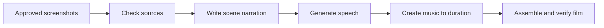
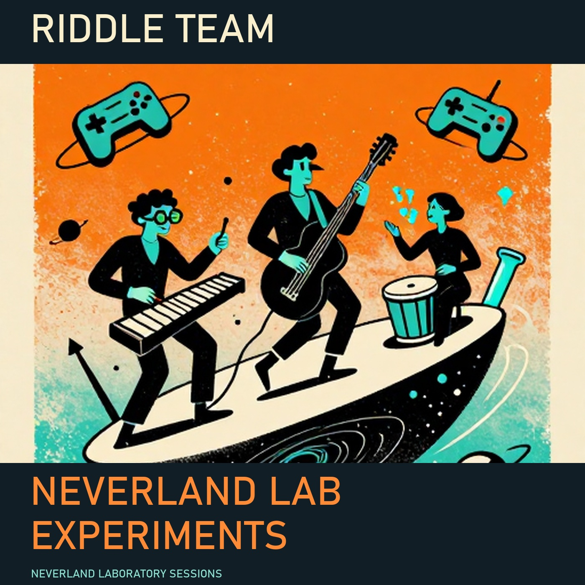

# What can an application do with a model’s judgment?

Ask an application to make an album: songs, lyrics, artwork and a band story that belong together. Someone has to carry the brief between writers and generators, check what came back, and assemble a result people can play. **Riddle makes those handoffs executable and repeatable. Ouroboros supplies the local inference.**

Here that job produced a twelve-song, 24-minute album with a cover, lyrics, a fictional band story and a downloadable player. A separate spell turned desktop screenshots into a narrated presentation. Another connected a local model to an existing robot controller and checked whether the can actually reached its destination.

These are executed workflows with recorded outputs. Their limitations matter too: the music still needs a listening judgment, a fast film had a worse final audio mix, and a simulated clap did not complete.

## The value of orchestration

A model can decide which scenes explain an idea or interpret a changed situation. Software can generate an asset, measure a file, move a simulated robot or check a result. A **spell** gives each part a defined input, a job, a place to send its answer and a condition for continuing.

The author describes the handoffs once. The operator can repeat the job, inspect an intermediate result, compare a changed instruction against a saved case, or hand the workflow to someone else. The workflow earns its setup when those instructions, checks and handoffs will matter again. Human preparation and review time have not been quantified by these timings.

Language becomes part of application logic: “choose the moments that make this explanation clear” asks for judgment inside a larger procedure. The next step receives the resulting scene list. It can commission illustrations, add narration and return a playable film. Each step's output remains something the application can inspect and use.

| Job the user wants done | What orchestration contributes | Recorded demonstration |
| --- | --- | --- |
| Produce a coherent media package | Carry one brief across text, images, sound and assembly; gather the finished files | [Riddle Team album](albums/neverland-lab-experiments/README.md): twelve songs, cover, lyrics, story and player |
| Explain a product using approved material | Connect source checks, local writing, narration, music and the final edit | [Inside Riddle Legacy](riddle-core-legacy/presentation/README.md): a 91-second film, produced locally in **1 min 56 s** |
| Operate through an existing robot controller | Turn measured observations into bounded model decisions and verify the physical result | [Panda placement](robotics/robosuite-pick-place/README.md): **20/20 ordinary placements and 20/20 recoveries** |
| Let the next person review or change the work | Retain the workflow, inputs, outputs and saved checks | [Desktop walkthrough](riddle-core-legacy/README.md): one passing saved example and a separate failed final writer |

## How a spell carries the work

A skill gives a model or tool one job. A spell connects those jobs. A cast is one execution with its own input and recorded results. Reusable groups let an author use the same preparation, review or action pattern in several workflows.

The presentation is a small, concrete example:

Its [published spell and storyboard](riddle-core-legacy/presentation/README.md#the-executed-workflow) show the application-level definition. The accepted production used seventeen local model calls. The diagram describes actual dependencies; it does not imply that every stage ran concurrently.

Spells can express branches, loops, reviews and conditional routes. Independent branches make available concurrency explicit; the engine and hardware determine the work that actually overlaps. The [legacy builder and Loom](riddle-core-legacy/README.md#follow-a-complete-run) show a calculation delivered to two reviewers and a final writer. Its final answer failed, which is exactly the sort of distinction the run record lets a reviewer inspect.

Local and cloud models can occupy different roles. In the album and presentation, Codex helped author the workflow and the measured production ran locally. The [provider screens](riddle-core-legacy/README.md#choose-where-inference-runs) show local, cloud and subscription connections. These examples do not measure an autonomous cloud supervisor managing the whole production.

## Where Ouroboros adds execution value

Ouroboros runs the supported local model work. Riddle describes what the work is for and how results connect. A repeated workflow can expose opportunities to keep compatible model work or context available between steps.

Measured examples on one RX 7900 XT workstation include:

| Work | Earlier or reference configuration | Compared configuration | Elapsed reduction |
| --- | ---: | ---: | ---: |
| Two-page wordless comic, prompt to PDF | ComfyUI image workflow: 304.82 s | Ouroboros image workflow: 237.90 s | **22.0%** |
| Six-panel image page | Fresh image session per panel: 362.44 s | One session for the page: 89.86 s | **75.2%** |
| Two-minute illustrated Mentats film | 1,461.22 s | 525.11 s | **64.1%** |

[Comparison conditions, repeated-text results, audio results and the Lemonade comparison](COMPARISONS.md) state what was measured. These engine/workload comparisons are separate from the executed-spell demonstrations above. Speed and output quality are separate findings.

## Watch, listen and inspect

| Showcase | Result |
| --- | --- |
| [Mentats and three science films](videos/README.md) | Downloadable illustrated films with narration and music |
| [Neverland Lab Experiments](albums/neverland-lab-experiments/README.md) | Twelve songs, cover, lyrics, fictional story, tour and player |
| [Local-model Panda](robotics/robosuite-pick-place/README.md) | Successful simulated placements and recovery; scripted reference also succeeds and is faster |
| [Supported humanoid movements](robotics/humanoid-movement/README.md) | Wave, thumbs-up and supported foot clips |
| [Pause/resume and cancel a wave](robotics/wave-lifecycle/README.md) | 20/20 cases: fourteen completed waves and six cancellations |
| [The clap limit](robotics/clap-admission/README.md) | 0/3 claps completed; all three attempts returned to neutral |
| [Riddle Legacy desktop](riddle-core-legacy/README.md) | Builder, execution history, Workbench, evaluations and provider settings |

The robotics pages distinguish local-model decisions from deterministic supported movements. Media quality remains reviewable rather than guaranteed. The measurements cover particular cases on one workstation, not every model, GPU or physical robot.
