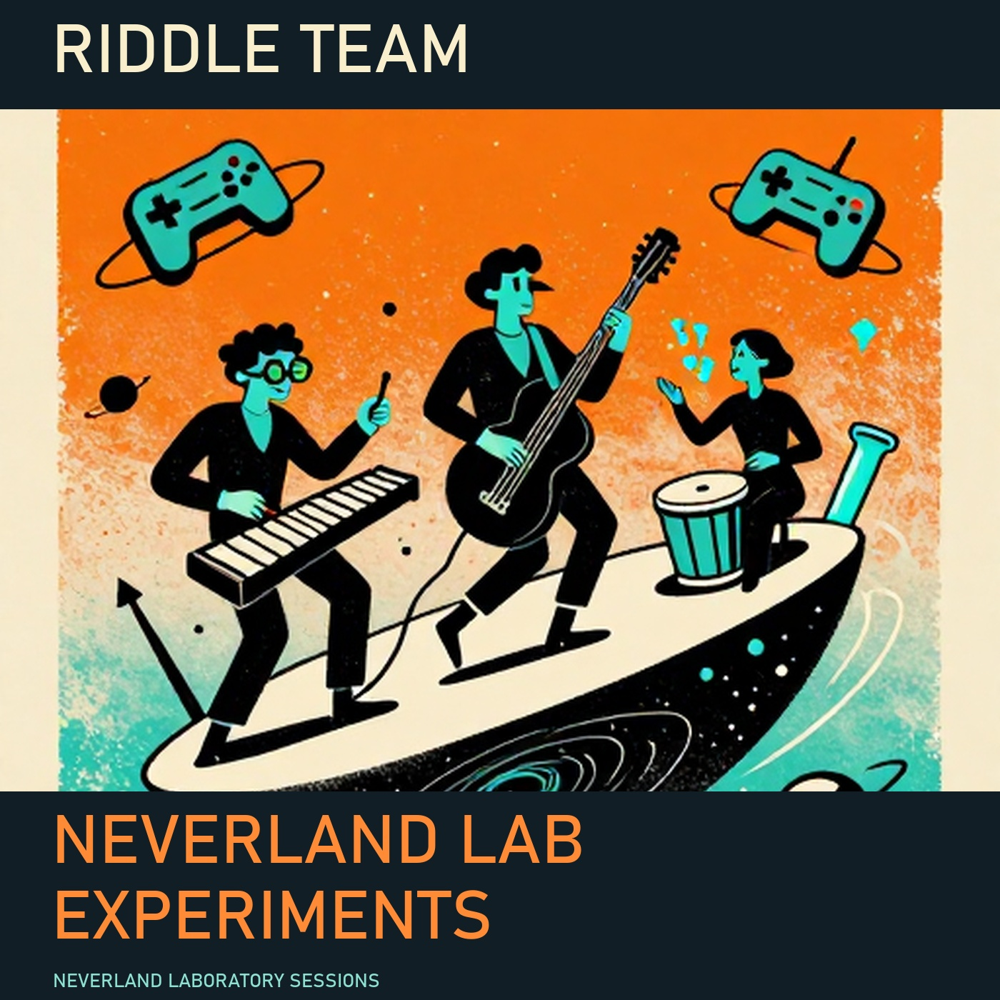

# Riddle Team — Neverland Lab Experiments

Twelve original songs about AI, physics, science and games. Twenty-four minutes of music, made on a Windows workstation with an AMD Radeon RX 7900 XT and 20 GB VRAM.

Riddle Team is a fictional band from the imaginary country Neverland. Codex planned the workflow and track briefs. Local text, image and music models produced the band story, tour, song drafts, artwork and performances. Ordinary software added cover lettering, mastered the recordings and assembled the album.

**[Listen to or download the full album · MP3, 35 MB](riddle-team-full-album.mp3?raw=true)**

[Download MP3, FLAC, artwork, lyrics and the offline player · ZIP, 377 MB](https://github.com/euvolen/ouroboros-results/releases/download/neverland-lab-experiments-2026-11-11/riddle-team-media.zip) · [Read the band story, fictional tour and lyrics](booklet.md)

The sound brief requested fast experimental funk and psychedelic soul, angular riffs, microtonal bends and energetic drums. The generation settings range from 138 to 166 BPM. Musical fidelity to that brief remains a listening judgment.

## Track list

| Track | Title | Length | MP3 |
| --- | --- | ---: | --- |
| 1 | Toaster for Mayor | 2:00 | [Listen / download](01.mp3?raw=true) |
| 2 | Schrödinger's Sofa | 2:00 | [Listen / download](02.mp3?raw=true) |
| 3 | Gravity Update Glitch | 2:00 | [Listen / download](03.mp3?raw=true) |
| 4 | Sock in the Multiverse | 2:00 | [Listen / download](04.mp3?raw=true) |
| 5 | Overfit Disco Robot | 2:00 | [Listen / download](05.mp3?raw=true) |
| 6 | Decaf the Space Time Continuum | 2:00 | [Listen / download](06.mp3?raw=true) |
| 7 | Side Quest Strike Force | 2:00 | [Listen / download](07.mp3?raw=true) |
| 8 | Black Hole Polka | 2:00 | [Listen / download](08.mp3?raw=true) |
| 9 | Dragon Wants a Spreadsheet | 2:00 | [Listen / download](09.mp3?raw=true) |
| 10 | Electron Traffic Jam | 2:00 | [Listen / download](10.mp3?raw=true) |
| 11 | Galaxy Buffering Blues | 2:00 | [Listen / download](11.mp3?raw=true) |
| 12 | Entropy's Cleaning Crew | 2:00 | [Listen / download](12.mp3?raw=true) |

## Recorded result

The album contains twelve two-minute songs, a full-album MP3, individual MP3/FLAC downloads, cover artwork, lyrics and an offline player. Production used local text, image and music models on the RX 7900 XT workstation.

The accepted music jobs reported **95.053 seconds combined** for 24 minutes of playback. This is not a complete production-time measurement: setup, rejected assets, text, artwork, mastering and packaging are outside that music-only sum.

The originals are stereo 48 kHz audio. All twelve MP3s, twelve FLACs and the full-album MP3 include the cover. A speech recognizer recovered seven of the twelve requested chorus hooks exactly; a human listening score has not been assigned.

[Measurements and file hashes](results.json) · [All showcases](../../README.md)
