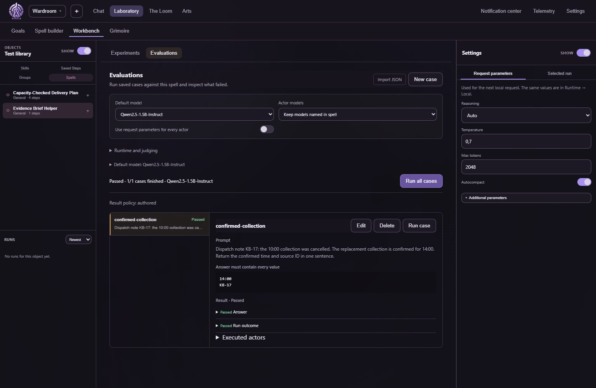
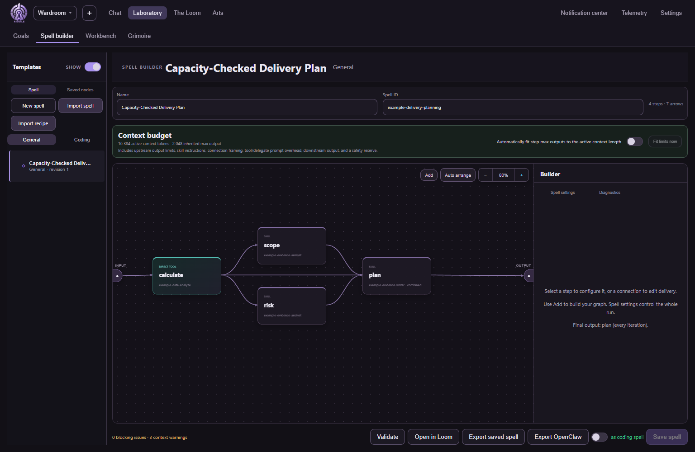
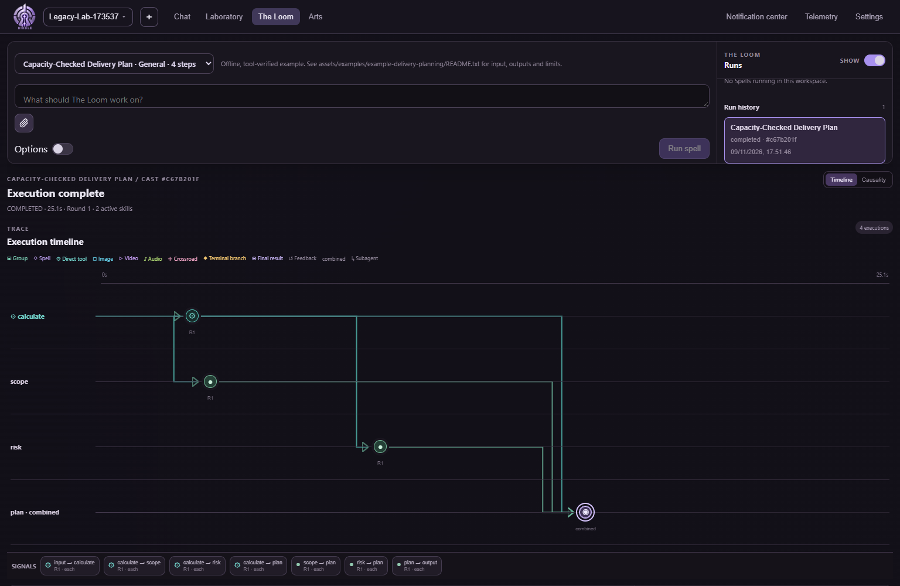
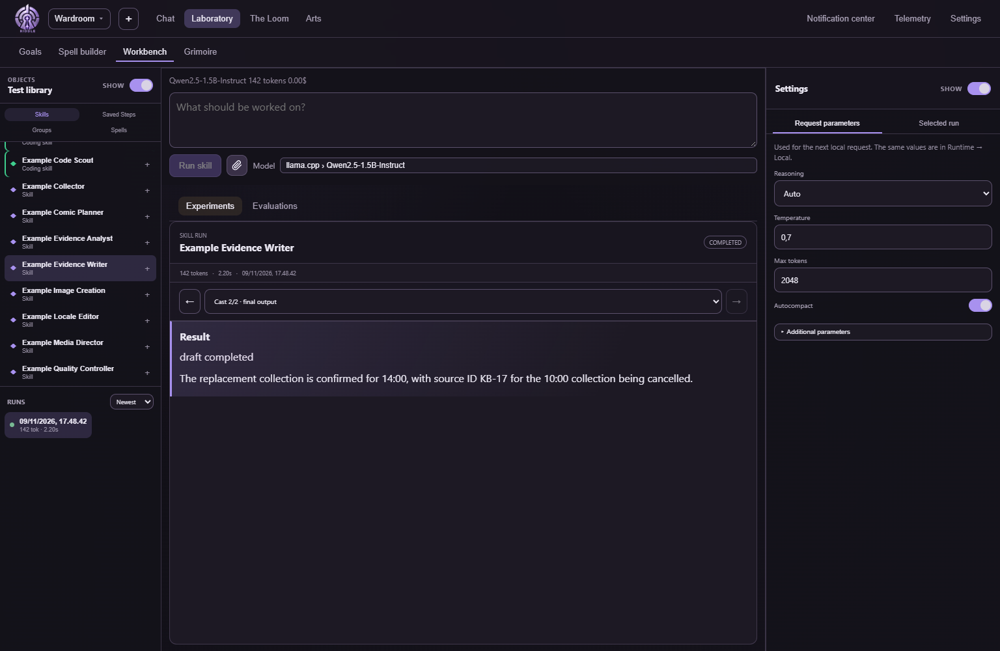
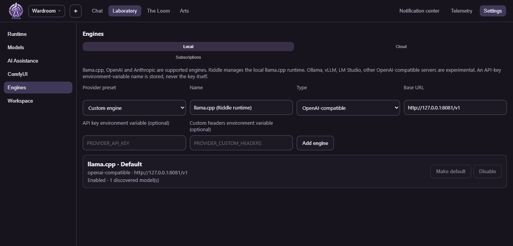
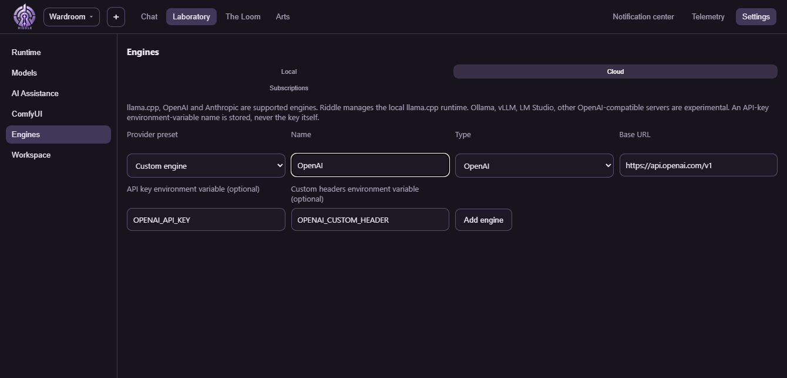
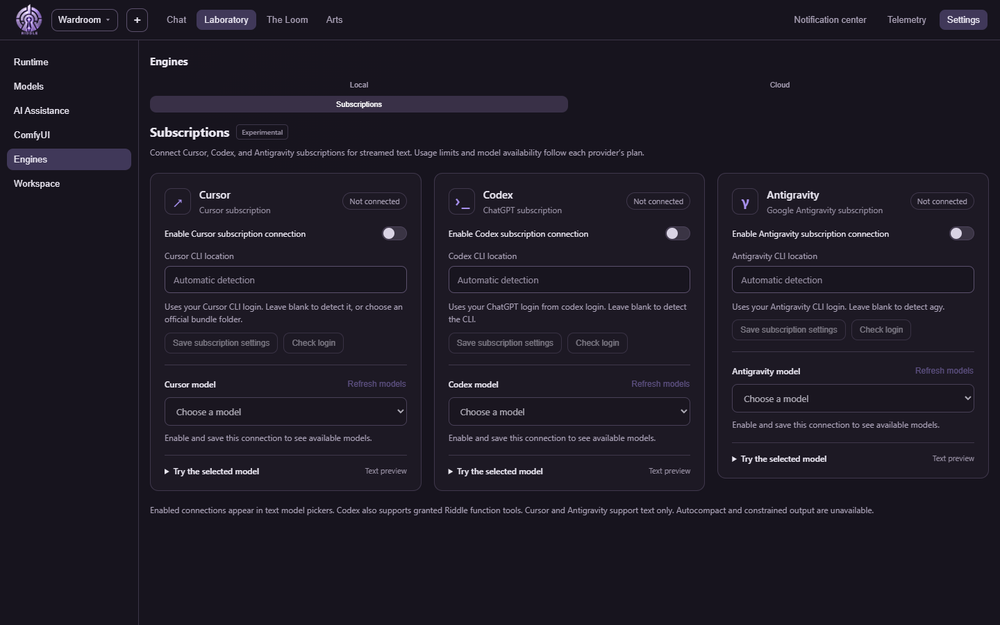

# Inside Riddle Legacy

[Watch the 91-second narrated presentation](presentation/inside-riddle-legacy.mp4?raw=true) · [Explore the executed presentation workflow](presentation/README.md)

## The second time you do the job

Yesterday’s dispatch note said the 10:00 collection was cancelled. The replacement was **14:00**, confirmed by **KB-17**. In a chat you can paste the note, ask for a brief and check the answer yourself. For a one-off, that may be all you need. Now imagine someone else taking the next shift. What would you hand them so they could do the job and tell whether their answer was any good?

In the legacy desktop we gave a local model the note. Its brief included the replacement time and its source. We also saved that example with two required values. Now someone editing the instructions or switching the model can run yesterday’s example again and see if either fact disappears. The expected time belongs to **this example**. Tomorrow’s note supplies tomorrow’s time.

That check passed once. It would also pass an answer that mentioned both times without saying which was cancelled. A dispatcher still has a meaningful decision to make: should the check require the brief to distinguish a cancelled collection from a confirmed one? Saving the case gives the next person a specific mistake to look for.

### When is it worth building a workflow?

| Something you find yourself doing | What you can hand over in Riddle Legacy |
| --- | --- |
| Pasting the same instructions and reminding the model what counts as a good answer | A saved task and examples to run after the instructions or model change. Workbench keeps the outputs for comparison. |
| Copying a calculation into two reviews, then piecing together a final answer | A spell that delivers the calculation to both reviewers and their findings to the writer. The Loom records what each actually received. |
| Starting over because one reviewer used the wrong input | The run history and its intermediate outputs. The graph API can rerun a step or its dependent branch and mark affected results stale. |
| Asking a teammate to repeat a process on their machine | A workspace with the definitions and evaluation cases. The teammate configures the required models and connections locally and can inspect their own run. |
| Repeating a known check at intervals | A Ritual that runs the saved workflow, records each iteration and prevents overlap. It can be paused or steered. |

The setup costs time. A task earns that time back when the instructions, handoffs or checks will matter again. We have measured model and workflow elapsed times. How much human preparation or review time this saves remains an open question.

### Where the other features earn their place

- **While exploring**, chat can branch from an earlier answer, and useful thought cards can be saved to the Grimoire. A person can try alternatives before deciding which steps deserve a permanent place.
- **When evidence is scattered**, workspace Knowledge can find passages in an indexed local collection. A skill can receive permission to search it. A separate writer can work from the evidence passed to it. Search snippets and generated summaries still need review.
- **When the next step depends on the input**, a Crossroad routes to a specialist. A delegated skill can have its own model and narrower tool permissions. A review step can send a draft back for a bounded revision.
- **When a result needs an action**, a step can call a schema-checked tool directly. The coding agent can inspect a project and propose edits under its approval settings. Saved MCP connections let a workspace expose selected external tools.
- **When you know the outcome before you know the steps**, a Goal can propose work from granted skills and submit a candidate for review against acceptance criteria. Runtime Assistance can help turn a recipe into workspace material for review.
- **When someone else needs to operate it**, a Scroll freezes a spell definition, a Capsule can pin workspace dependencies, and the API lets another client run and watch a job. Per-step usage helps explain which model accounted for tokens and estimated spend.

## Follow a complete run

A **skill** gives a model one job. A **spell** connects skills and tools. A **cast** is one execution, with its own inputs, outputs and history.

We asked the desktop to plan a delivery using four tasks and ten days of capacity. A tool supplied the figures, two model steps examined them, and a final step tried to write the plan. Following that cast from the builder to its result shows where a workflow can succeed mechanically and still disappoint its reader.

### Organize work in workspaces

A workspace brings a project's skills, spells, tools, evaluations and assets together. You could keep a comic studio in one workspace, a research workflow in another, and coding experiments in a third. Each workspace has its own saved conversations and run history.

Use the workspace menu at the top left to switch projects. The **+** button creates a workspace from a template or starts an empty one with base tools. You can also import a workspace from a local folder or Git repository. Open **Settings → Workspace** to change its name, description and appearance, or manage its container.

| Part | What it holds |
| --- | --- |
| Workspace content | Editable skills, spell graphs, tools, evaluations and project assets |
| Execution history | Saved run records and results associated with that workspace |
| Workspace container | The project's running service and installed tools, with access to its workspace and runtime directories |
| Shared inference setup | The station's model catalog, loaded models and measured configurations, available across workspaces |

Switching workspaces keeps the station's inference setup available and leaves existing workspace services running. A spell step can still select its own model. Running a package spell requires its workspace container to be started.

To share a workflow, share its workspace package and prepare the required models and connections on the receiving machine. The recipient can inspect the definitions, edit the skills, run the saved evaluation cases and cast the spell against their own inference setup.

For a more precisely specified environment, Workspace Capsule tooling can package definitions with image and model locks, provenance and optional saved state. Activation checks the required dependencies. Credentials are supplied locally. Capturing the environment helps repeat a workflow; generated answers still need evaluation.

For this walkthrough, the delivery-planning spell ran in a disposable example workspace with its own container and run records.

### Build the workflow in the Laboratory

Open **Laboratory → Spell builder** and select **Capacity-Checked Delivery Plan**. Read the graph from left to right. **Calculate** runs a tool against the example task data. Its output goes to **scope**, **risk**, and the final **plan** step. The two analysis steps also send their findings to **plan**. Those arrows determine which evidence is available when the writer runs.

Select a step to inspect its instructions, model binding and tool access. Select a connection to inspect how it delivers an output. **Validate** checks the graph before saving. This example had four steps, seven arrows, zero blocking issues and three context warnings.

### Cast it and read the Loom

Start the workspace container, choose the saved spell, enter the delivery request and select **Run spell**. Open the completed cast in **The Loom → Run history**. The timeline locates each execution in time. The **Signals** row lists the actual handoffs. Selecting an execution opens its inputs and output.

On this station, the cast completed all four steps in **25.1 seconds**. The calculation supplied nine days of effort and a seven-day critical path. The final model output was a tool-call-shaped fragment where a reader needed a milestone plan. A completed trace answered “Did the steps run?” An evaluation of the deliverable would also need to ask “Did the reader get a usable plan?”

### Try one part in Workbench

Open **Laboratory → Workbench → Experiments**. The library lets you choose a skill, a saved step, a group or a whole spell. Start with a small input so you can tell exactly where a mistake enters.

For a second example, we selected **Example Evidence Writer** and supplied a dispatch note. The 10:00 collection had been cancelled and the 14:00 replacement was confirmed by source **KB-17**. The local model returned the new time and the source ID. Workbench retained the result and reported **142 tokens and 2.20 seconds**. Select a run in the left column to revisit its draft and final output.

### Turn the example into a repeatable check

In **Workbench → Spells**, select **Evidence Brief Helper**, then **Evaluations → New case**. Enter the dispatch prompt, choose **Contains every value**, and put `14:00` and `KB-17` on separate lines. Save the case and select **Run case**. The report shows the assertion results and the actors that actually ran.

The one-step spell passed **1/1 cases** on local Qwen2.5-1.5B-Instruct. The check establishes that both expected strings occurred and execution succeeded. It leaves open whether the wording is clear or whether the answer also contains a contradictory time. For the larger delivery spell, a useful case would check the capacity figures, dependencies and presence of an actual milestone plan.

### Choose where inference runs

Open **Settings → Engines**. The connection you configure here supplies choices to chat and spell model pickers. A step can inherit the run's model or pin a particular one.

| Route | How to set it up | What the choice means |
| --- | --- | --- |
| **Local** | Use the managed llama.cpp engine. **Models** is where you add or download weights. **Runtime** is where you validate, load and unload the selection. | The selected local model runs on the station. This walkthrough used CPU inference. **Settings → ComfyUI** manages the separate media workflow and model setup. |
| **Cloud** | Choose an OpenAI or Anthropic preset, set the endpoint and supply the **name** of the environment variable holding the API key. Discover models, then select one. | Requests use that API connection and its billing. Other compatible endpoints are experimental. |
| **Subscriptions** | Enable a provider card, save the CLI location or use automatic detection, check the existing login and choose an available model. | Riddle uses the installed provider CLI. Cursor, Codex and Antigravity have desktop cards. The provider account determines availability and usage limits. |

**Local engine.** The enabled llama.cpp endpoint discovered the model used for the example runs.

**Cloud engine.** The OpenAI preset fills in the protocol and API endpoint. The credential field takes an environment-variable name.

**Subscription connections.** These experimental cards offer a login check, model selection and a streamed text preview. An explicitly selected subscription stays bound to that connection and model. Unsupported requests fail before inference. The Codex connection can also use explicitly granted Riddle function tools in supported sessions. The screenshots show disconnected accounts. All inference in this walkthrough ran locally.

*Captured November 9, 2026, using the legacy desktop frontend and desktop API in a browser with disposable example workspaces. Timings are single-run observations. The delivery cast and the dispatch-note evaluation are separate examples. The [Ouroboros benchmark results](../README.md) cover separate engine comparisons.*
