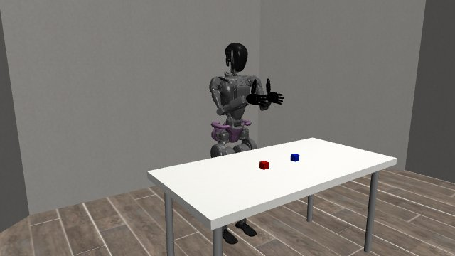

# A limit: the clap did not complete

**None of the three tested clap requests completed.** The poses were rejected for collisions before the hands closed. All three attempts returned to neutral.

[Watch the recorded approach and return — 3.15 s](assets/blocked-clap.mp4).

| Outcome | Result |
| --- | ---: |
| Completed claps | **0/3** |
| Verified neutral returns | 3/3 |

No successful clap is shown or claimed. This is an anchored GR1 simulation with deterministic targets. Playback uses simulation time and omits waits. The failed poses do not establish that every other posture is impossible or qualify physical robot safety.

[Case outcomes](cases.csv) · [Measurements](results.json) · [File checksums](SHA256SUMS.txt) · [All showcases](../../README.md)
