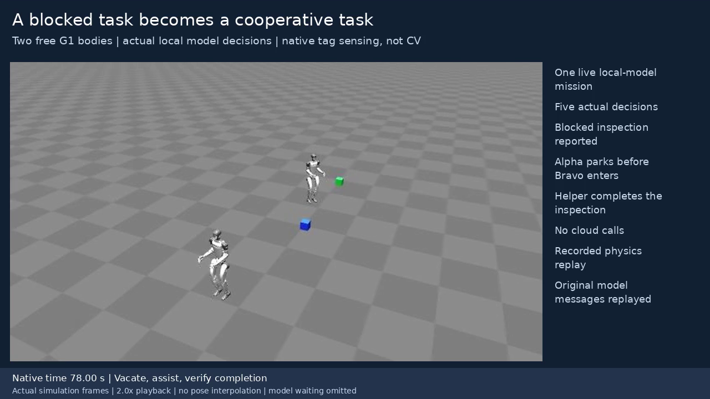

# Robots that can ask for help

An inspection becomes blocked. Alpha reports the limitation, a local manager
arranges assistance, Alpha moves to parking, and Bravo enters the station and
completes the inspection.

This **3 minute 14 second film** brings together measured examples of walking,
reacting, speaking, observing and cooperating. Ouroboros runs the local models;
Riddle connects their decisions to reusable workflows and existing numerical
robot controllers.

**[Watch or download the film](assets/humanoid-showcase.mp4)** — landscape,
1280 × 720, with narration, approximately 6.3 MB.

## What the application gains

A model can interpret a request, report a limitation or propose help. Existing
controllers keep the simulated body balanced and execute admitted actions.
The workflow connects those responsibilities, carries observations between
roles and checks the physical outcome before reporting completion.

The assistance scene uses five actual local-model decisions. The walking
controllers continue independently of model response time. A blocked job
becomes a coordinated handoff of work, with the first robot vacating the area
before its helper enters.

## Chapters

| Approximate start | What is shown |
| --- | --- |
| 00:00 | Reusable supported hand/body groups |
| 00:27 | A physically free humanoid walking |
| 00:47 | Revised goals, holds and reactions |
| 01:18 | Spoken requests and local management |
| 01:39 | Changed and occluded robot-camera views |
| 02:04 | Two bodies sharing one simulated room |
| 02:38 | A blocked inspection and coordinated assistance |
| 02:58 | What the demonstration establishes and its limits |

These chapters combine separately checked episodes. Supported GR1 gestures
and camera trials are distinct from free-body G1 locomotion and cooperation.
The film is not one uninterrupted mission in which one body performs everything.

## Recorded results

| Case | Completed result |
| --- | --- |
| Free full-body walking | 20 fresh cases; 23 actuated joints using an existing gait policy |
| Combined act/react | 20 fresh 60-second cases, including revised instructions, obstruction and loss of usable sensing or authority |
| Spoken requests during continued simulation | Four requests in one continuous 180-second world |
| Changed camera scenes | Four cases: red visible, changed to green, blue occluded, blue restored |
| Two-body shared-room comparison | 20 matched variations in three modes: 60 completed physical cases |
| Mean simulated task duration | Parallel **15.221 s**; sequential **26.447 s**; shared-area reservation **23.679 s** |
| Managed assistance | One live local-model mission, five model decisions, then 20 numerical confirmation variations |

The numerical confirmation variations replay decisions; they are not twenty
new model conversations. Completed counts include recovered infrastructure
attempts and are not first-attempt workflow success rates. The timing comparison
is between execution strategies in these cases, not a comparison against another
robotics framework or a GPU-kernel speedup.

## Local production and existing foundations

Devstral Small 2 24B supplies text decisions and narration. Qwen2.5-VL 7B handles
the camera trials; Whisper base.en recognizes synthetic spoken requests; Piper
supplies the voices. Production inference runs locally on an RX 7900 XT/CPU
workstation. Codex assists with authoring, implementation and review.

Motion and physics build on [MuJoCo](https://github.com/google-deepmind/mujoco),
[robosuite](https://github.com/ARISE-Initiative/robosuite),
[LocoMuJoCo](https://github.com/robfiras/loco-mujoco) and
[Unitree's existing deployment/policy work](https://github.com/unitreerobotics/unitree_rl_gym).
This is an orchestration and integration demonstration, with no claim of newly
invented walking or first-in-field language-model robotics. Related work includes
[SayCan](https://arxiv.org/abs/2204.01691),
[RoCo](https://github.com/MandiZhao/robot-collab) and
[EmbodiedAgents](https://github.com/automatika-robotics/embodied-agents).

## Reading the film honestly

- All robot footage comes from simulation. No physical robot was tested.
- Playback speed is labelled. Model waiting is omitted, and the final frame of
  an excerpt may be held while narration finishes. Robot poses are not interpolated.
- The scene/pose map uses recorded simulator data. It is not camera perception.
- The assistance scene uses native tag observations and an explicit processing
  permission difference. It does not demonstrate camera-guided free walking.
- The wider cooperation view is a physics replay of the actual recorded model
  decisions. Native movements and policy inputs match the original mission.
- Local models produced the narration. The cooperation chapter quotes original
  application model instructions rather than a new paraphrase.
- A frozen media replay produces an identical MP4. This does not mean new model
  calls always make identical choices.
- Grasping, physical object handover, quiet standing and hardware safety remain
  unqualified.

The value shown is a local workflow that connects bounded model judgment to
measured actions and exposes whether the work actually finished. It is not a
claim of general robot autonomy or universal reliability.
