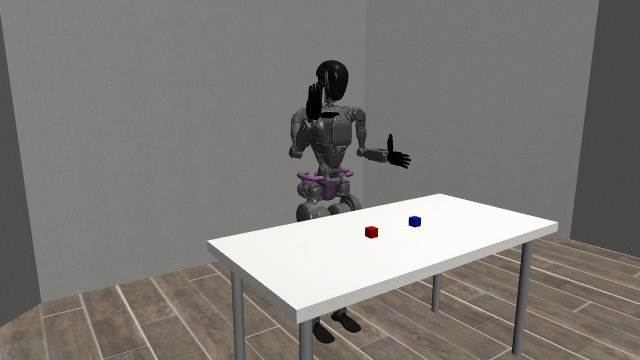
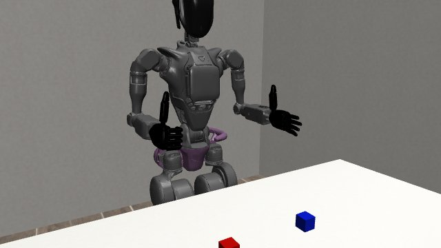
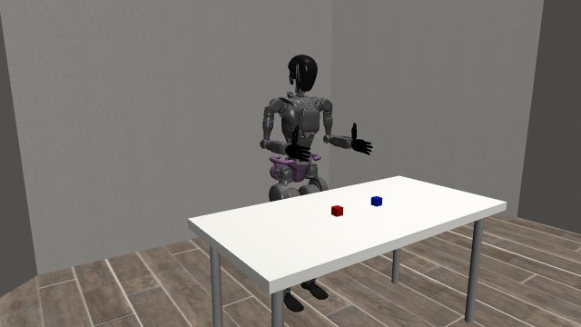

# Supported humanoid movements

Recorded GR1 simulations show a wave, thumbs-up and supported foot movement. **31 movement profile types** passed in the sampled supported postures in this dated result.

| Wave | Thumbs-up |
| --- | --- |
|  |  |
| [Watch — 8.2 s](assets/rolled-wave.mp4) | [Watch — 6.8 s](assets/thumbs-up.mp4) |

[Watch the supported foot — 2.65 s](assets/supported-foot.mp4).

| Activity | Recorded outcome |
| --- | ---: |
| Individual movement profiles | 180/180 cases |
| Named joint movements | 220/220 programs |
| Arm, torso and supported-foot poses | 100/100 cases |
| Fist and pointing shapes | 80/80 lifecycle cases |
| Thumbs-up | 40/40 lifecycle cases |

The thumbs-up cohort includes **28 completed shapes and twelve cancellations with verified opening**. It does not represent forty completed gestures.

The pelvis is anchored. These clips demonstrate supported movement, not walking or balance. Targets were deterministic, and recordings play at twenty simulation frames per second while omitting planning and rendering waits. Opening an empty hand does not demonstrate release of an object.

The scene used robosuite 1.5.2 / MuJoCo 3.3.7 with CPU rendering on a Ryzen 9 5950X workstation.

[Later wave pause/resume showcase](../wave-lifecycle/README.md) · [Measurements](results.json) · [File checksums](SHA256SUMS.txt) · [All showcases](../../README.md)
