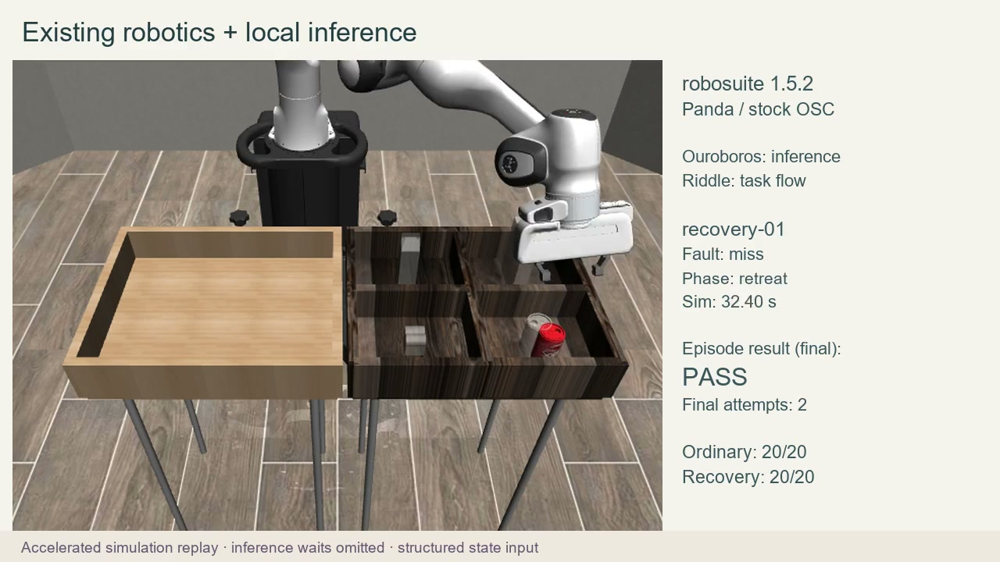

# A local model directing a simulated robot

A stock simulated Panda picks up a can, places it in its marked compartment and recovers after a missed grasp or slip. Local-model decisions completed **20/20 ordinary placements and 20/20 recoveries**. A scripted reference passed the same cases too.

[Watch the narrated replay — 59.83 seconds](assets/replay.mp4?raw=true). Playback accelerates movement and omits inference waits.

| Task | Scripted reference | Local-model decisions |
| --- | ---: | ---: |
| Ordinary pick-and-place | 20/20 | 20/20 |
| Placement after a missed grasp or slip | 20/20 | 20/20 |

There were forty distinct held-out scenes, each tested under both configurations: eighty episodes in total. Every recovery episode recorded an unsuccessful first attempt before completing placement.

| Twenty-episode cohort | Scripted reference | Local-model decisions |
| --- | ---: | ---: |
| Ordinary placement, elapsed total | 75.80 s | 173.42 s |
| Recovery, elapsed total | 125.70 s | 287.89 s |

These clocks cover the episode loop and exclude setup and replay production. Simulation was unpaced and paused for model decisions; the numbers are not robot reaction latencies. The scripted reference was faster on this fixed task, so this result demonstrates integration rather than a speed or model-quality advantage.

The decision model was Devstral Small 2 24B Instruct Q4_K_M on a Windows / RX 7900 XT workstation. The scene used robosuite 1.5.2 and MuJoCo 3.3.7. Observations were structured simulator state. Physical hardware and camera-only grasping remain unproven.

[Case outcomes](cases.csv) · [Measurements](results.json) · [File checksums](SHA256SUMS.txt) · [All showcases](../../README.md)
