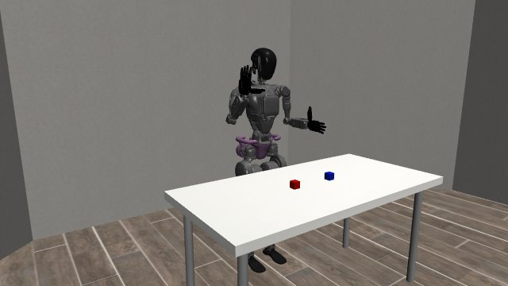

# Pause, resume and cancel a wave

The supported GR1 passed **20/20 cases**: seven ordinary waves, seven paused and resumed waves, and six cancellations with return. That means **fourteen completed waves and six successful cancellations**.

| Pause and resume | Cancel and return |
| --- | --- |
|  |  |
| [Watch — 8.85 s](assets/pause-resume.mp4) | [Watch — 5.2 s](assets/cancel-return.mp4) |

| Measurement | Recorded result |
| --- | ---: |
| Maximum endpoint position error | 3.72 mm |
| Maximum joint drift while held | 0.000793 rad / 0.0454° |

These are actual simulator recordings at twenty simulation frames per second. Playback omits planning and rendering waits. The pelvis is anchored, and targets are deterministic. These results do not qualify free-body balance or physical hardware.

[Case outcomes](cases.csv) · [Measurements](results.json) · [File checksums](SHA256SUMS.txt) · [All showcases](../../README.md)
