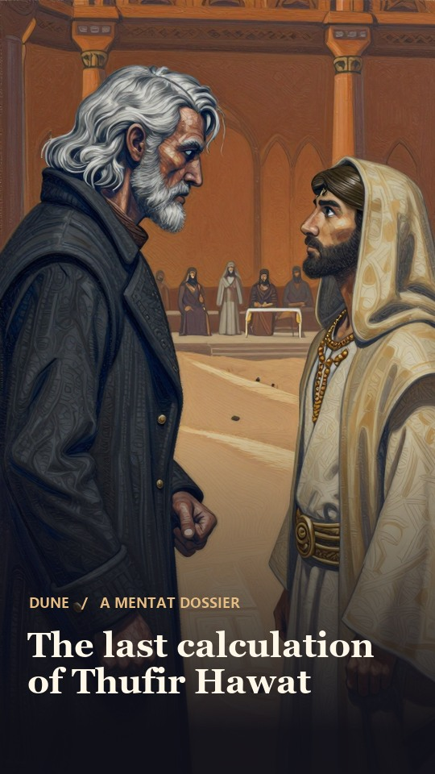

# Generated video results

Five finished MP4s from the November 9, 2026 experiments on Windows with an AMD Radeon RX 7900 XT, 20 GiB VRAM. Each film combines generated portraits, local narration, music, captions and image pans or zooms. Open a video through its link or select a poster below.

| Film | Playback length | Recorded production time | File |
| --- | ---: | ---: | --- |
| The last calculation of Thufir Hawat · separate portrait jobs | 2 min | 24 min 21.224 s | [Watch or download](mentats-baseline.mp4?raw=true) |
| The last calculation of Thufir Hawat · grouped portrait jobs | 2 min | 8 min 45.111 s | [Watch or download](mentats-grouped.mp4?raw=true) |
| Inside a gasoline engine | 25.37 s | Ready 2 min 53.058 s after the science batch started | [Watch or download](science-engine.mp4?raw=true) |
| Why a moving clock ticks slowly | 26.10 s | Ready 3 min 34.894 s after the science batch started | [Watch or download](science-relativity.mp4?raw=true) |
| Why physicists proposed M-theory | 30.77 s | Ready 4 min 23.236 s after the science batch started | [Watch or download](science-m-theory.mp4?raw=true) |

The **three science films together took 4 min 23.242 s**. Their completion times share one starting point. The run used fixed scripts, fresh native processes and previously downloaded weights. Its clock includes profile verification, narration, music, twelve portraits, editing and verification.

| Mentats baseline | Mentats grouped | Gasoline engine | Relativity | M-theory |
| --- | --- | --- | --- | --- |
|  |  |  |  |  |

## What changed in the Mentats run

Both versions tell the same two-minute story with eighteen portraits, eighteen narration segments and a continuous score. The clock starts with the prepared script and ends with the verified film and exported source assets. Setup, research and gallery transfer fall outside it.

| Stage | Separate portrait jobs | Grouped portrait jobs |
| --- | ---: | ---: |
| Music | 39.307 s | 23.428 s |
| Eighteen voice lines | 135.782 s | 141.630 s |
| Eighteen portraits | 1,209.556 s | 285.629 s |
| Picture edit, sound mix and verification | 75.686 s | 73.265 s |
| Complete timed workflow | **1,461.224 s** | **525.111 s** |

Elapsed time fell **64.06%**, or about **15 min 36 s**, in this pair of runs. Every portrait matched its baseline counterpart. The grouped run admitted four image requests at a time while one sampler was active at a time.

The final audio needs further work. Against the 299-word script, the speech recognizer made 42 word edits on the baseline mix and 131 on the grouped mix. Recognizing each scene independently from the final audio gave 42 and 45 edits. Both downloadable versions retain their measured mixes.

## Verification

All five uploaded files match their recorded SHA-256 hashes and passed a fresh full decode. They contain 1080 × 1920 H.264 video and AAC audio. The measurements are single-run observations. Human creative approval remains pending.

Before the final music mix, the science narration checks recorded 2 speech-recognition word edits against 71 reference words for the engine film, 1 against 78 for relativity, and 7 against 71 for M-theory.

[Download the timings and file checksums](results.json) · [Return to the main results](../README.md)
